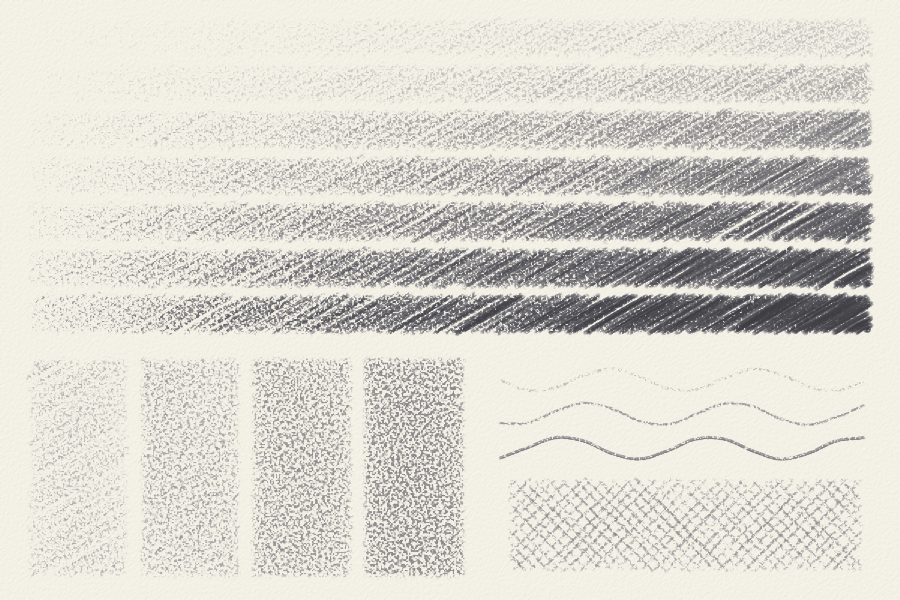
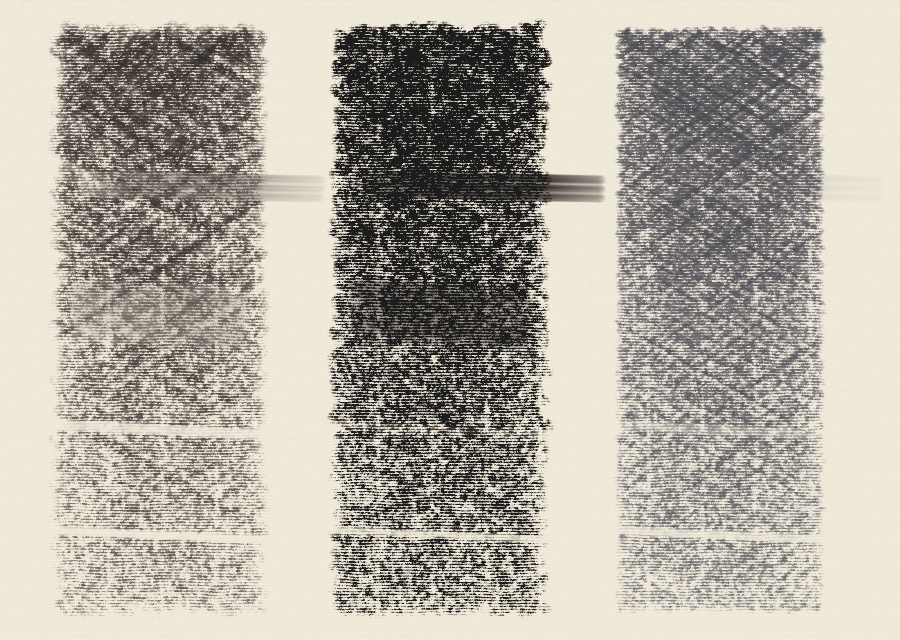

# fusain

[](https://github.com/joce/fusain/actions/workflows/ci.yml)
[](https://codecov.io/gh/joce/fusain)
[](https://github.com/astral-sh/ruff)
[](https://github.com/psf/black)
[](https://github.com/joce/fusain/blob/main/LICENSE)

A drawing simulator for dry and semi-dry media: graphite and coloured pencils,
charcoal, pastel, crayon and the like, laid down on a paper with tooth. Wet
media (ink, felt-tip markers, paint) are out of scope; for oil paint, see the
sister project [oilpaint](https://github.com/joce/oilpaint). The two share their
colour science and stroke paths through [murex](https://github.com/joce/murex).

Early days. So far there are papers, graphite pencils from 9H to 9B, charcoal,
stumps and erasers. Tone depends on how hard a stick is pressed and how many
layers are laid, as on real paper; charcoal leaves dust that a stump drags
about and an eraser lifts, while graphite mostly stays put. Pastel, colour and
worn tips are still to come; the plan is in [docs/design.md](docs/design.md).

```python
from fusain import Sheet, papers, pencils

sheet = Sheet(800, 600, paper=papers.CARTRIDGE, seed=1)
sheet.stroke([(100, 300), (300, 220), (500, 320)], pencils.B2, pressure=0.6)
sheet.shade((100, 360, 500, 520), pencils.HB, pressure=0.4)             # an even tone
sheet.shade((100, 360, 500, 520), pencils.HB, pressure=0.4, angle=-40)  # a second layer, across
sheet.save("drawing.png")
```



Top: 4H, 2H, HB, 2B, 4B, 6B and 8B, each shaded with the pressure rising from
left to right. Bottom left: HB at a light pressure in 1, 2, 4 and 8 layers.
Bottom right: 2B lines drawn lightly, firmly and hard, and cross-hatching.

Sizes are in pixels, and the paper's `grain` sets the scale: a pencil line is
two or three grains wide.

```python
from fusain import charcoal, tools

sheet.shade((100, 60, 500, 200), charcoal.VINE, pressure=0.6, width=14)
sheet.smudge([(120, 130), (560, 130)], tools.STUMP)    # drags the dust along
sheet.erase([(100, 170), (500, 170)], tools.KNEADED)   # lifts it
```



Vine charcoal, compressed charcoal and a 4B pencil on Ingres paper. Across all
three, from the top: untouched; a stump dragged through and out onto the bare
paper; a finger rubbed to and fro; a kneaded eraser pulled through three
times; a vinyl eraser pulled through once.


The papers of `fusain.papers` under a raking light: cartridge, printer paper,
Bristol, newsprint, Ingres, cold-pressed; rough, sanded card, toned grey, toned
tan, black.

## Development

```bash
uv sync --group dev --frozen   # install the package and the development tools
uv run pytest                  # run the tests (the first run compiles the numba kernels)
make pre-push                  # what CI runs: tox, coverage, spelling
```

## License

[MIT](LICENSE)
