# fusain

[](https://github.com/joce/fusain/actions/workflows/ci.yml)
[](https://codecov.io/gh/joce/fusain)
[](https://github.com/astral-sh/ruff)
[](https://github.com/psf/black)
[](https://github.com/joce/fusain/blob/main/LICENSE)

A drawing simulator for dry and semi-dry media: graphite and coloured pencils,
charcoal, pastel, crayon, ballpoint pen and the like, laid down on a paper with
tooth. Wet media (ink, felt-tip markers, paint) are out of scope; for oil
paint, see the sister project [oilpaint](https://github.com/joce/oilpaint).
The two share their colour science and stroke paths through
[murex](https://github.com/joce/murex).

Early days. So far there are papers, graphite and coloured pencils, charcoal,
soft, hard and oil pastels, wax crayons, ballpoint pens, stumps, erasers and
a knife. Tone depends on how hard a stick is pressed and
how many layers are laid, as on real paper. Charcoal and pastel leave dust
that a stump drags about and an eraser lifts; coloured pencils are waxy and
translucent, so their layers mix to the eye, a colourless blender burnishes
them, and an eraser slides on them: their lights are kept, or scratched out
with a knife. A light pastel covers a dark one.
Crayons and oil pastels leave a film of wax that dry media hardly take over,
even one firm line of it (wax resist); drawn over dust, they lie on it and
bind part of it. An oil pastel is a paste, which a finger smears and a
kneaded eraser does not lift.
A point wears as it draws, until it is sharpened. A hard pencil pressed
firmly flattens the tooth, and a stylus indents a line that a tone shaded
over it skips. Heavy graphite shines under the lamp, polished wax has a soft
gloss and heavy ballpoint ink bronzes. Fixative sets the dust. The plan for
the rest is in [docs/design.md](docs/design.md).

```python
from fusain import Sheet, papers, pencils

sheet = Sheet(800, 600, paper=papers.CARTRIDGE, seed=1)
sheet.stroke([(100, 300), (300, 220), (500, 320)], pencils.B2, pressure=0.6)
sheet.shade((100, 360, 500, 520), pencils.HB, pressure=0.4)             # an even tone
sheet.shade((100, 360, 500, 520), pencils.HB, pressure=0.4, angle=-40)  # a second layer, across
sheet.stroke([(100, 560), (500, 550)], pencils.B4, tilt=1)             # with the side of the lead
sheet.stroke([(560, 300), (760, 200)], pencils.B2, width=lambda u: 8 - 6 * u)  # a stroke that tapers
sheet.stroke([(560, 400), (760, 400)], pencils.B2, width=6, ends="flat")      # cut square at its ends
sheet.save("drawing.png")
```

## Six drawings made with it

Each is a single script where every mark is a `sheet.stroke(...)`, or the
pass of a stump, a finger or an eraser; numpy only decides where the marks
go. None is copied from a picture. Each subject is first built (a tower, a
street, a bird, a table of things and a lake in space, lit and looked at
through a camera; the farm as flat shapes, as its manner asks), and the
medium is then laid along the forms that result.

* `examples/deco.py`: a sketch of an imagined art deco tower, in charcoal on
  a cream paper. The shadow faces are toned up the wall and rubbed with a
  stump, the cast shadows hatched the way the light falls, the windows drawn
  strip by strip between their piers; the sky is vine charcoal rubbed with a
  finger, and the building is lifted back out of it with a kneaded eraser
  (about 7,900 strokes and 1,700 rubs, under a minute).
* `examples/broadway.py`: Broadway in SoHo on an autumn afternoon, in soft
  pastel on toned paper. Blocked in with the side of the stick, rubbed and
  fixed; then each cast-iron front in strokes that run with the perspective,
  the roadway, the trees in broken dabs, the cabs and the people, each a
  body in a pose drawn in a handful of strokes; the brightest touches last
  (about 32,500 strokes, under a minute).
* `examples/macaw.py`: a great green macaw in coloured pencil on white
  paper. The bird is a solid model (`examples/macaw_model.py`) whose
  proportions were measured on several photographs of the species, posed and
  lit; the pencil goes on darks first, each colour hatched lightly and then
  stroked along the lie of the feathers, with the head carried furthest.
  The feathers and the bill are then burnished with a colourless blender,
  and the lights scratched out of the wax with the point of a knife (about
  36,700 strokes, over a minute).
* `examples/stilllife.py`: a still life in blue, black and red ballpoint. A
  jug, a bottle, a bowl of cherries, apples and a striped cloth are built as
  solids and lit; the pen then works patch by patch, laying bundles of
  strokes that follow each form wherever tone is still wanting. Red is the
  fruit, blue the shadows on white things, the jug's pattern and the cloth's
  stripes, black the darkest places (about 11,300 strokes, about a minute).
* `examples/lake.py`: morning mist on a mountain lake, in graphite. Far to
  near is also hard lead to soft: the sky is a soft lead laid very lightly on
  its side and rubbed with a finger until its grain is gone; the ridges are
  rubbed to a haze; the far forest is massed in 2B and pulled down into the
  mist with a stump; the mist and the lights on the water are lifted with
  erasers; the near spruces carry the full weight of 8B; and the boat is
  drawn with a sharp point (about 37,000 strokes, 700 rubs and 700 passes of
  an eraser, about three minutes).
* `examples/farm.py`: a farm on a hill in wax crayon, as naive art has it:
  no perspective, everything from its most telling side, bold flat colour.
  Wax resists what comes after it, so the order is a crayon's: black
  outlines first on bare paper, then the patterns, then the colours
  scribbled over them, light before dark; the whites are paper (about
  11,600 strokes, under a minute).

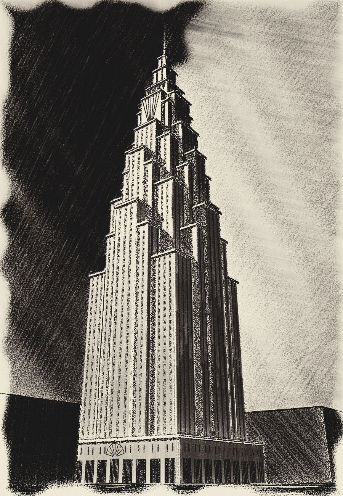

*An imagined setback skyscraper of the 1930s, in charcoal: vine and
compressed charcoal, a stump, a finger and a kneaded eraser, on a cream paper
with an irregular tooth.*

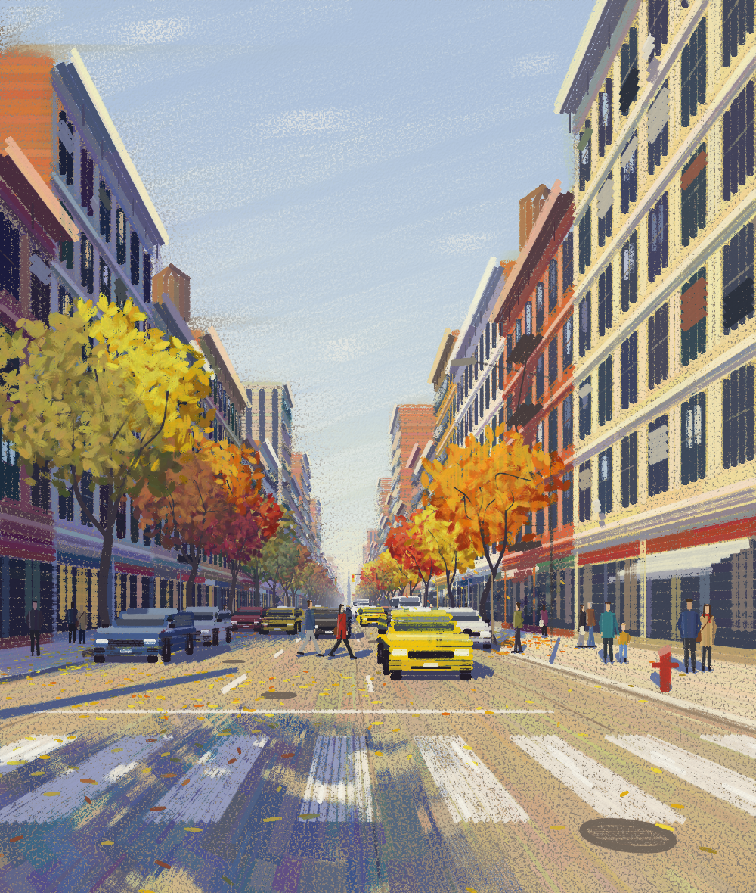

*Broadway in SoHo on an autumn afternoon, in soft pastel on toned paper: the
sun low behind the left shoulder, so the fronts on the right are lit and the
left side lays its shadow across the street.*

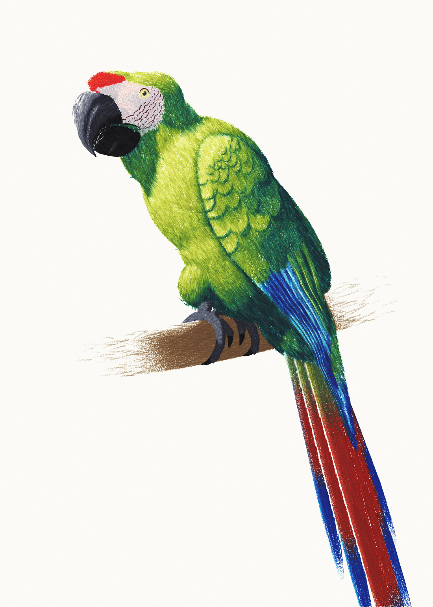

*A great green macaw in coloured pencil: built from measured proportions,
then drawn darks first, each colour stroked along the feathers, burnished
with a colourless blender, its lights scratched out with a knife.*

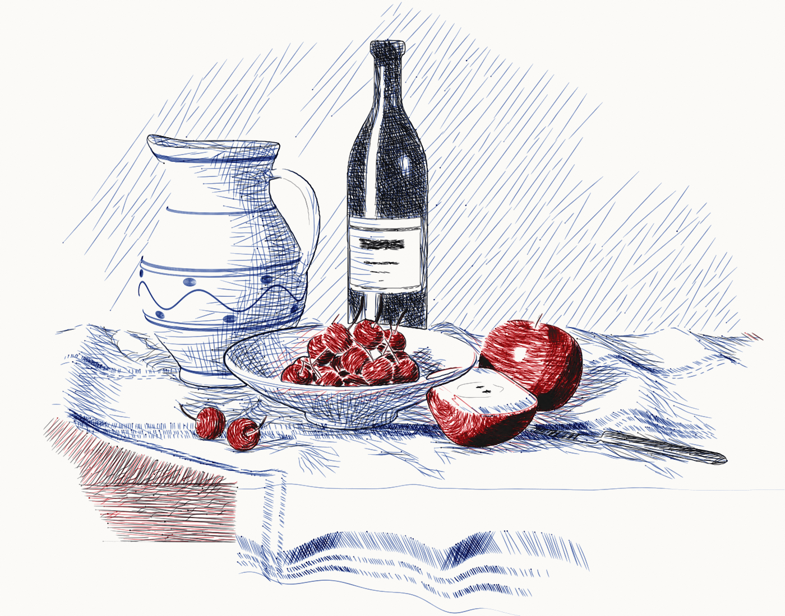

*A still life in blue, black and red ballpoint, every tone a hatching that
follows its form: the highlights are bare paper, and the inks mix only where
their lines cross.*

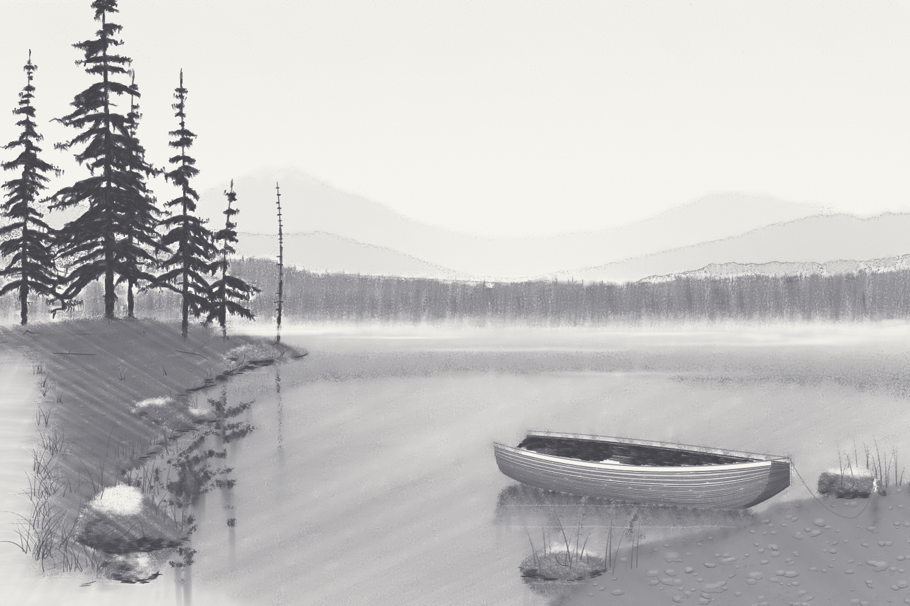

*Morning mist on a mountain lake, in graphite: 4H to 8B, the point and the
side of the lead, finger, stump and chamois, kneaded and vinyl erasers.*

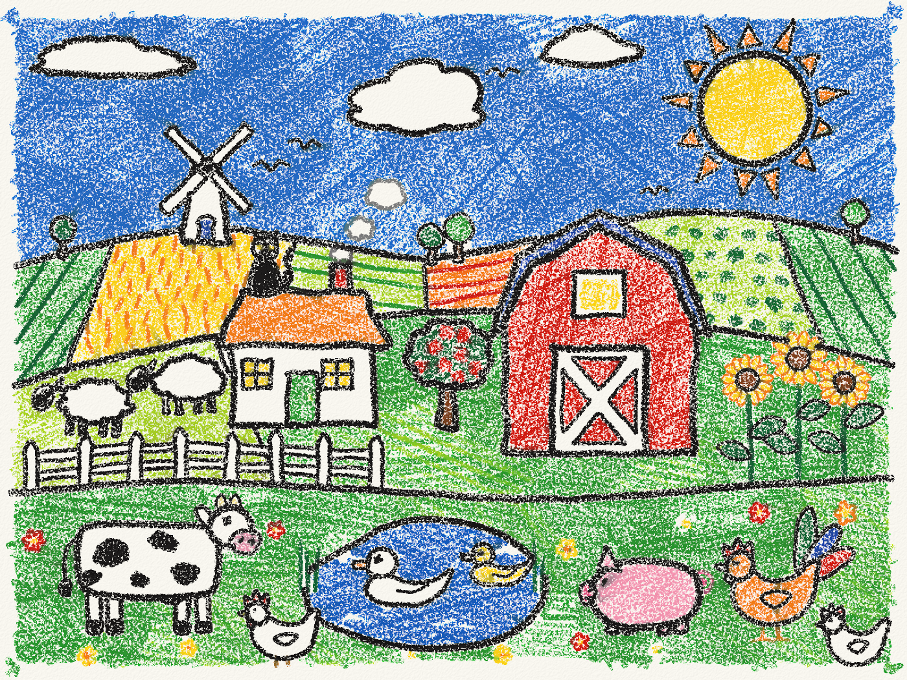

*A farm on a hill in wax crayon: outlines first, then patterns, then colour
scribbled over them, the paper left for every white.*

## The media

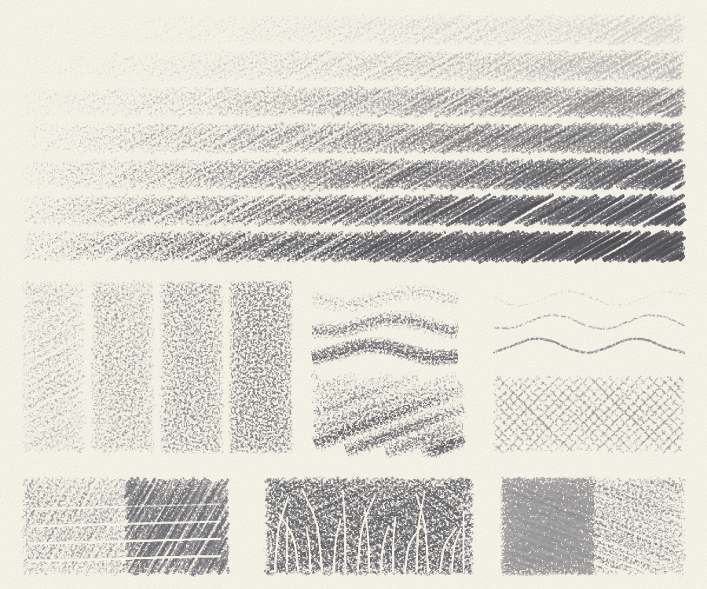

Top: 4H, 2H, HB, 2B, 4B, 6B and 8B, each shaded with the pressure rising from
left to right. Middle left: HB at a light pressure in 1, 2, 4 and 8 layers.
Middle: a 4B held on its side (`tilt=1`), which marks a broad, soft,
grainy band. Middle right: 2B lines drawn lightly, firmly and hard, and
cross-hatching. Bottom, what the pencil does to the paper. Left: five lines
indented with a stylus, lightest to firmest, under a 2B shaded lightly (left
half) and hard (right half). Middle: blades of grass indented first, which
stay white under a 4B. Right: a 2H pressed hard over the left half, then one
light layer of 4B over all of it, grainy on the tooth left alone and even on
the flattened one.

Sizes are in pixels, and the paper's `grain` sets the scale: a pencil line is
two or three grains wide.

```python
sheet.indent([(100, 300), (400, 320)], pressure=0.7)   # a stylus: it lays nothing, and leaves a groove
sheet.shade((80, 260, 420, 360), pencils.B2, pressure=0.5)   # the groove stays the white of the paper
```

A tip rides on the paper either side of a groove and marks only what it
reaches down to: indent whiskers, grass or a highlight firmly before shading
and they stay white; a groove indented lightly fills in under a soft pencil
pressed hard. A firm ballpoint line is such a groove too. And a hard pencil
pressed firmly flattens the tooth (`Sheet.press`): what is shaded over it
afterwards lies evenly, without the grain, and the paper bites it less.

```python
from fusain import Smudger, charcoal, tools

sheet.shade((100, 60, 500, 200), charcoal.VINE, pressure=0.6, width=14)
sheet.smudge([(120, 130), (560, 130)], tools.STUMP)    # drags the dust along
sheet.erase([(100, 170), (500, 170)], tools.KNEADED)   # lifts it
sheet.rub((100, 60, 600, 200), tools.FINGER)           # blends a whole area

stump = Smudger(tools.STUMP)             # a stump in the hand keeps what it picks up
sheet.rub((100, 60, 300, 200), stump)    # loaded, it gives back as much as it takes
sheet.smudge([(620, 80), (760, 120)], stump)           # and draws a pale tone on bare paper
stump.clean()
```

A bare tool (`tools.STUMP`) is clean every time it is put to the paper: it
leaves the tone lighter where it lands and takes away what it lifted. A
`Smudger` is a tool in the hand, as a `Stick` is a medium in the hand: it
keeps its load from one pass to the next, so a tone can be worked over and
over without being worn away, and a stump loaded on a dark patch (of the
drawing, or of a scrap sheet) draws soft greys of its own. One load fades
out over twenty or so widths of the tool. `Sheet.rub` carries the load from
pass to pass either way.

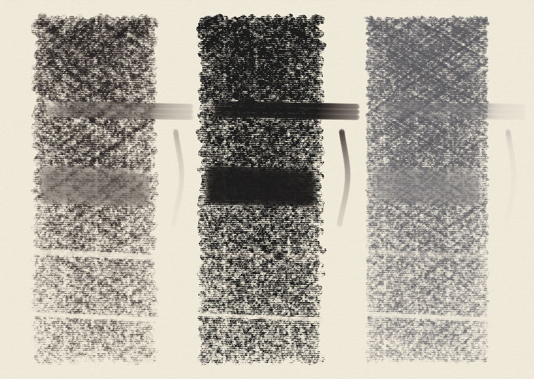

Vine charcoal, compressed charcoal and a 4B pencil on Ingres paper. Across all
three, from the top: untouched; a stump dragged through and out onto the bare
paper, then loaded in the tone once more and drawn down the bare paper beside
it; a finger rubbed to and fro; a kneaded eraser pulled through three times;
a vinyl eraser pulled through once.

```python
from fusain import pastels

sheet.shade((100, 60, 300, 200), pencils.coloured("#2456a6"), pressure=0.7)
sheet.shade((200, 60, 400, 200), pencils.coloured("#f2c40f"), pressure=0.7)  # green where they overlap
sheet.shade((100, 60, 400, 200), pencils.BLENDER, pressure=1.0)              # burnish: the white specks close
sheet.erase([(120, 100), (380, 110)], tools.KNIFE)                           # scratch a light out of the wax
# build colour in light layers (pressure about 0.3): ten or so go on before the wax resists.
# Press a layer hard and it fills and polishes the tooth, and little will take over it.
sheet.stroke([(100, 300), (400, 320)], pastels.soft("#f4f1ea"), pressure=0.8, width=14)
```

A colourless blender (`pencils.BLENDER`), pressed hard, burnishes coloured
pencil: it presses the wax into the valleys of the tooth, so that the white
flecks of the paper close and the colour is deeper, more saturated, smoother
and a little glossy. One firm layer of it leaves a fifth of the flecks, two
next to none; pressed lightly it does nothing. It stirs what it goes over,
so two colours laid over each other become one, and an edge it is drawn
across is dragged out by a tip's width or so. (A white or a light pencil
pressed hard burnishes too, less thoroughly, and adds its colour.)

Wax holds against an eraser. A light layer of coloured pencil comes off a
vinyl eraser fairly well; a dense one comes off by degrees, a burnished one
hardly (three rubs to and fro leave it as dark as it was), and a kneaded
eraser barely touches any of them. So the lights of a coloured pencil
drawing are kept from the start, by leaving the paper or by indenting a line
(`Sheet.indent`), or taken out with something that cuts: the point of a
knife (`tools.KNIFE`) scratches a fine line back to the paper, and a sand
eraser (`tools.SAND_ERASER`) abrades a patch. And a dark goes on over a
light only while the tooth has room: on a paper with a shallow tooth, which
four light layers fill, lay the darks first.

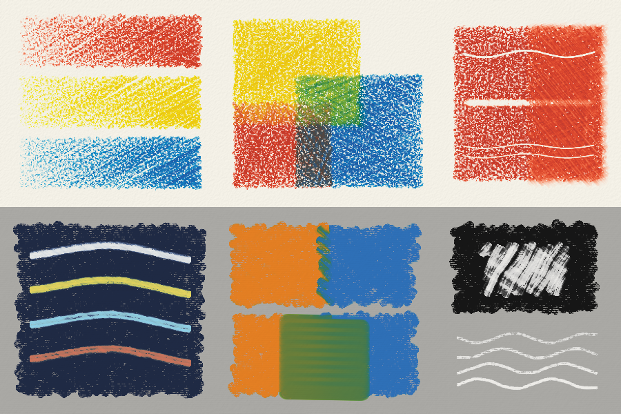

Top, coloured pencils on cartridge paper. Left: red, yellow and blue, lighter
to firmer. Middle: the same three laid over one another: green, orange and
violet where two overlap. Right: three layers of red, the right half then
burnished with a colourless blender; across both halves, a line indented
before the red was laid, a vinyl eraser rubbed to and fro (it slides on the
burnished half) and two lines scratched with a knife. Bottom, soft pastels
on grey laid paper.
Left: light colours over a dark blue ground, which they cover. Middle: orange
and blue side by side, and the same with the join rubbed with a finger. Right:
white pastel over black, and lines drawn with a hard pastel.

```python
sheet.fix()   # fixative: the dust stays where it is, and takes more layers
# the tooth is full of pastel after five or six layers; fix between stages, as a pastellist does,
# and a light pastel covers a heavily worked dark one again.
```

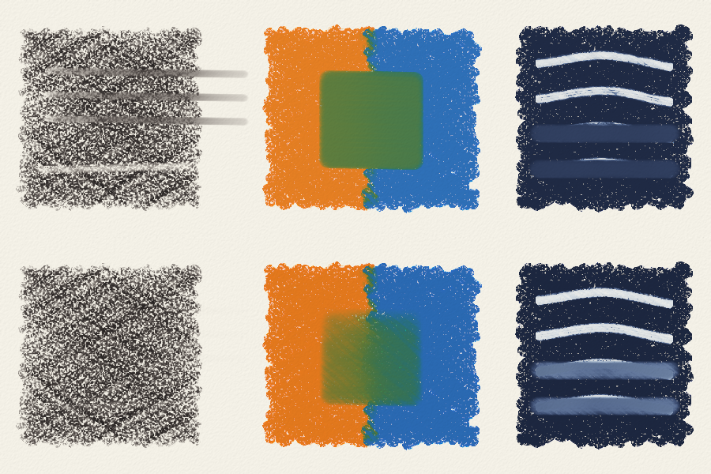

The same drawing rubbed alike twice; the bottom one was sprayed with fixative
first. Left: vine charcoal, a stump dragged through and a kneaded eraser
pulled through. Middle: orange and blue pastel, the join rubbed with a finger.
Right: white pastel strokes laid over a dark ground after the fixative, the
lower two rubbed with a finger.

```python
from fusain import crayons

sheet.shade((100, 60, 300, 200), crayons.wax("#c0392b"), pressure=0.6, width=9)
sheet.shade((100, 260, 300, 400), pastels.oil("#e67e22"), pressure=0.7, width=14)
# wax resist: draw in crayon, one firm line is enough, and shade charcoal over it
sheet.stroke([(100, 460), (300, 480)], crayons.wax("#f4f1ea"), pressure=0.9, width=7)
sheet.shade((80, 430, 320, 510), charcoal.COMPRESSED, pressure=0.4, width=12)
```

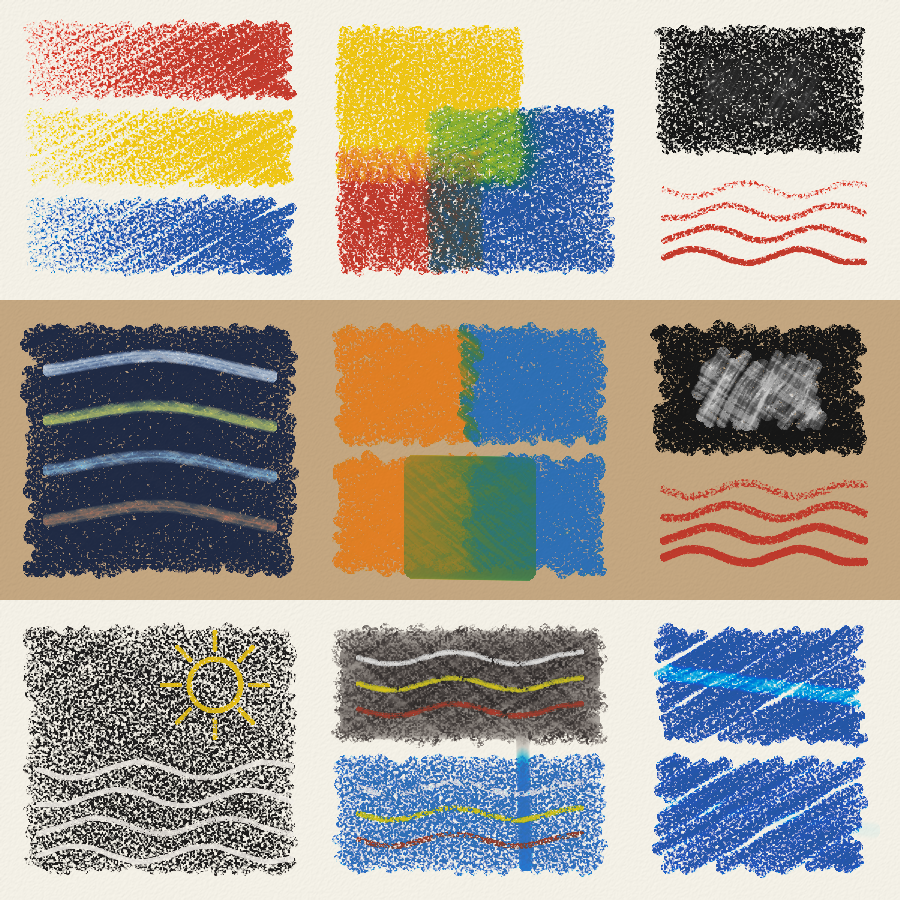

Top, wax crayons on cartridge paper. Left: red, yellow and blue, lighter to
firmer. Middle: the same three laid over one another. Right: a white crayon
over a black one, which it does not cover, and lines drawn lighter to firmer.
Middle, oil pastels on tan paper. Left: light colours over a dark blue ground,
which they half cover. Middle: orange and blue side by side, and the same with
the join rubbed with a finger. Right: white oil pastel over black, and lines
drawn lighter to firmer.
Bottom, what lies over what. Left: a sun and waves in one firm line of crayon
each, and charcoal shaded over all of it, which skips the wax. Middle: crayon
lines drawn over rubbed charcoal and over soft pastel lie on the dust, and a
stump dragged down through them moves the dust and not the lines. Right: a
kneaded eraser pulled through soft pastel, which it lifts, and through oil
pastel, which it does not.

```python
from fusain import HeldPen, pens

sheet.stroke([(100, 300), (400, 320)], pens.BLUE, pressure=0.6)
sheet.shade((100, 60, 300, 200), pens.BLACK, pressure=0.4, angle=35)   # hatching
sheet.stroke(path, pens.BLUE.with_(blots=0))                           # a pen that never blots

pen = HeldPen(pens.BLUE)        # in the hand: it lands with the ink its ball gathered
sheet.stroke(path, pen)
sheet.shade((100, 60, 300, 200), pen, pressure=0.4)
pen.wipe()
```

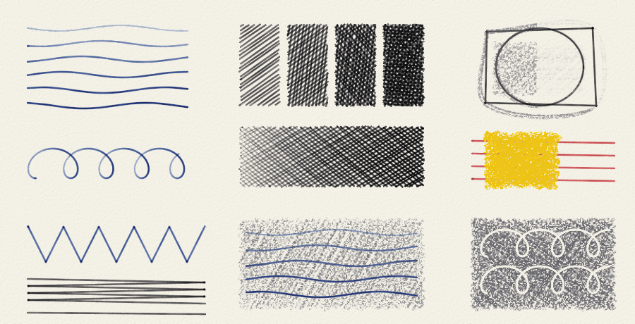

Left: lines from the lightest touch to the firmest, and loops as a hand writes
them. Middle: hatching in one to four layers, and one layer pressed lighter to
firmer. Right: a pencil sketch inked over, its right half then rubbed with an
eraser, which takes the pencil and leaves the ink; and a red pen skidding
across a patch of wax crayon. Bottom left: the ball gathers ink as it rolls,
and leaves a blob where the line turns sharply and, now and then, where it
starts; the scribble is written with a pen in the hand that lands with what
it gathered on the line under it. Bottom middle: the ball presses a groove, which a soft pencil shaded
over it skips where the pen was firm. Bottom right: loops written with a pen
that has run dry (`sheet.indent`), shaded over.

```python
from fusain import Stick

pencil = Stick(pencils.B6, width=2)      # a sharp point, which wears as it draws
sheet.stroke([(100, 400), (700, 420)], pencil)
print(pencil.width)                       # wider than 2 now
pencil.sharpen()

vine = Stick(charcoal.VINE, width=6, lead=6, side=90)   # a piece of charcoal 90 pixels long
sheet.stroke([(100, 500), (700, 500)], vine, tilt=1)    # laid flat: a band 90 pixels wide
```

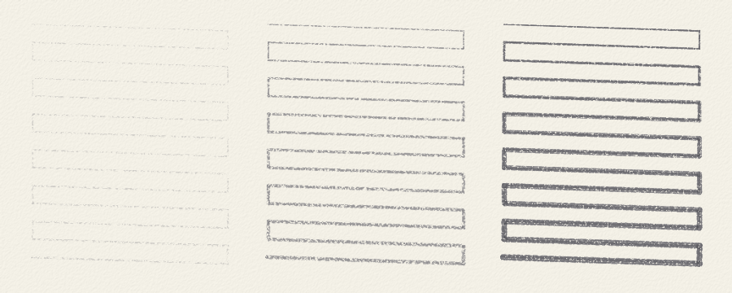

One line drawn back and forth down the sheet without sharpening, with a 2H, a
2B and a 6B, each sharp at the top: the softer the lead, the sooner its point
is a flat and its line a band.

A stroke ends round, in the outline of its tip, or flat, cut square across
at the ends of its path; either way it is as strong at its ends as in its
middle, and a short dab as strong as a long stroke. Its width and its tilt
can change along it, as its pressure can:

```python
sheet.stroke(path, pastels.hard("#2b2b3a"), 0.8, 14, ends="flat")    # as long as its path
sheet.stroke(path, pastels.soft("#f1ede2"), 0.7, [16, 3])            # narrows as it goes away
sheet.stroke(path, pencils.B6, 0.8, lambda u: 15 - 14 * u)           # tapers to a point
sheet.stroke(path, Stick(charcoal.VINE, 6, 6, side=110), tilt=lambda u: u)  # turned onto its side
```

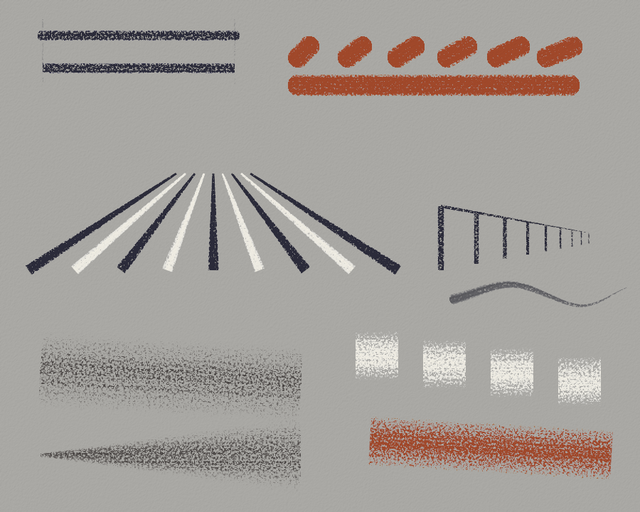

Top: round and flat ends between the same two ticks, and short dabs of a
broad soft pastel beside a long stroke of it. Middle: strokes that narrow as
they recede, a fence going away, and a 6B stroke that tapers. Bottom: a
piece of vine charcoal laid flat, a band as wide as it is long; the same
turned from its end onto its side as it goes; and a soft pastel laid flat in
flat-ended blocks.

```python
image = sheet.render()                    # under the default lamp, graphite shines a little
image = sheet.render(light=(0, 0, 1))     # lamp overhead: heavy graphite turns silvery
image = sheet.render(gloss=0)             # matte, as a scanner sees it
shiny = sheet.shine("wax")                # how much of each pixel shines: "graphite", "wax", "ink"
```

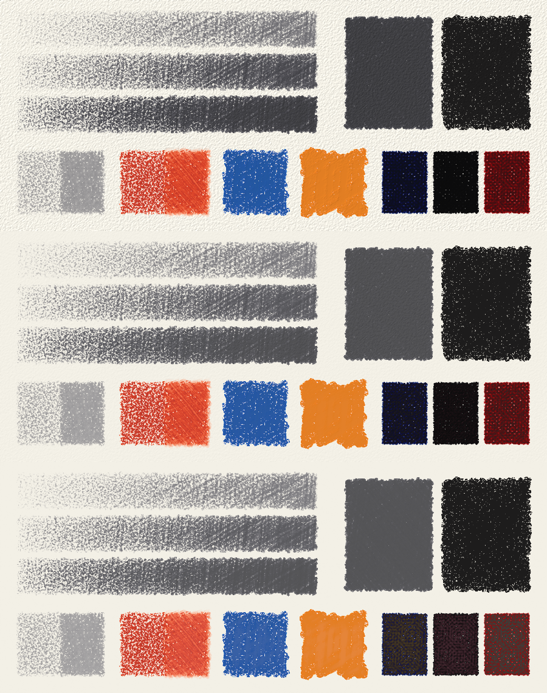

One drawing under a raking lamp, the default lamp and a lamp straight
overhead. Top row. Left: an HB, a 4B and an 8B, lighter to firmer. Right:
three firm layers of 8B beside three of compressed charcoal. The higher the
lamp, the more the heavy graphite mirrors it; the charcoal stays black.
Bottom row: a 2H laid lightly and pressed hard, which flattens the tooth so
that the little graphite it lays has a sheen; a coloured pencil, its right
half burnished; a crayon and an oil pastel pressed hard; and blue, black and
red ballpoint hatched eight times over. Three things shine, each in its own
way: graphite like metal; wax softly, once it is polished (the harder it was
pressed, the more), under any lamp; and heavy ink like bronze, in the colour
it absorbs most (black ink, a blend of dyes, in its violet's), with the lamp
overhead.

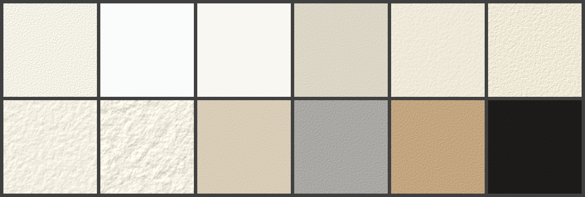

The papers of `fusain.papers` under a raking light: cartridge, printer paper,
Bristol, newsprint, Ingres, charcoal paper; cold-pressed, rough, sanded card,
toned grey, toned tan, black.

## Development

```bash
uv sync --group dev --frozen   # install the package and the development tools
uv run pytest                  # run the tests (the first run compiles the numba kernels)
make pre-push                  # what CI runs: tox, coverage, spelling
uv run python tools/fingerprint.py   # whether a change has altered the picture
uv run python tools/benchmark.py     # how long strokes, rubs and renders take
```

## License

[MIT](LICENSE)
