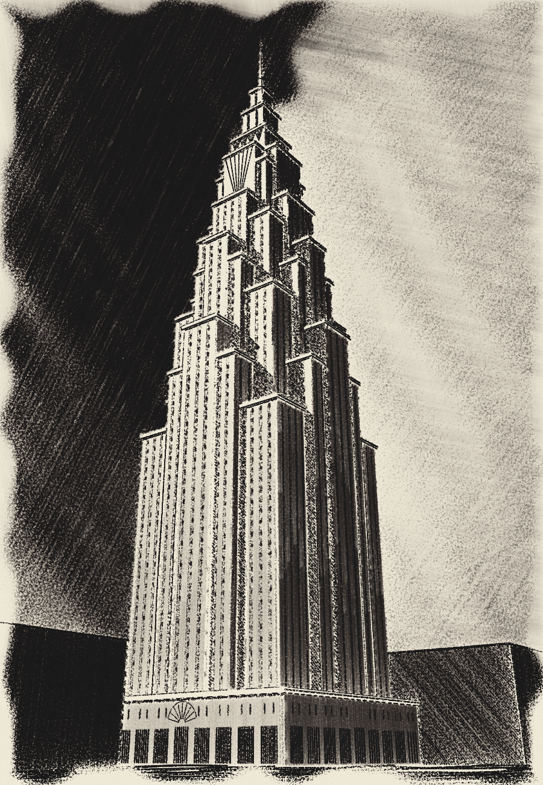
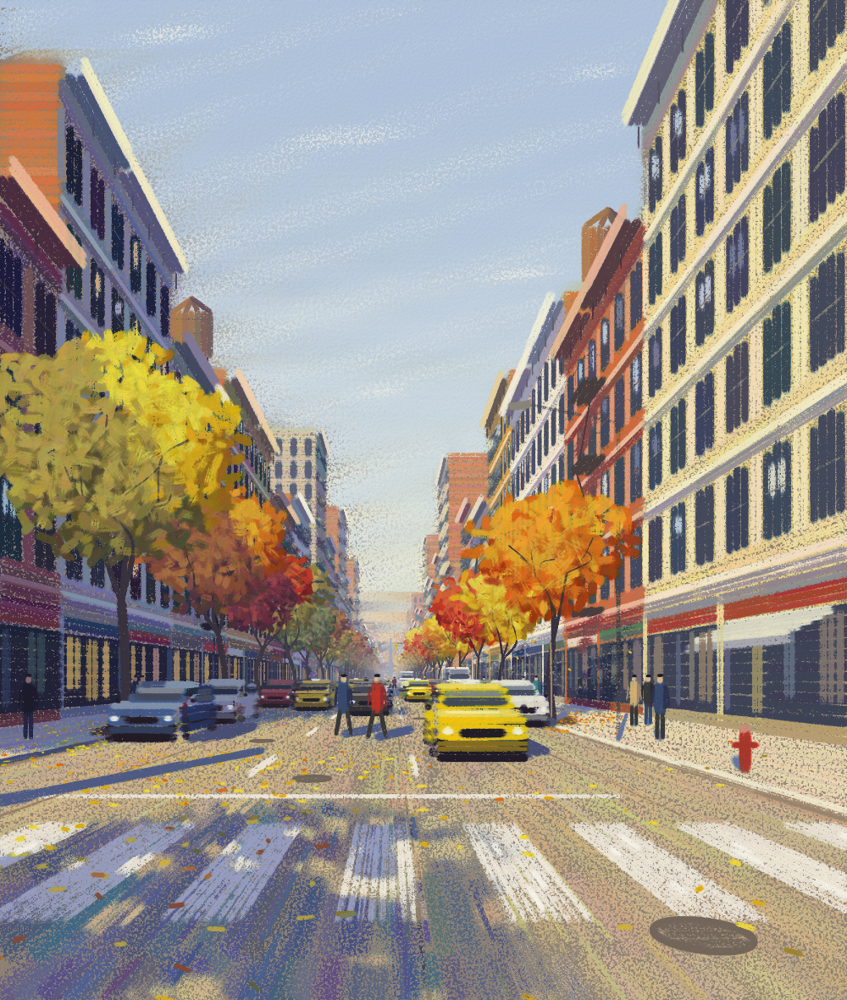
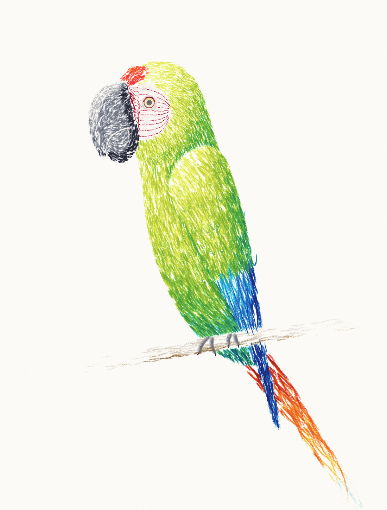
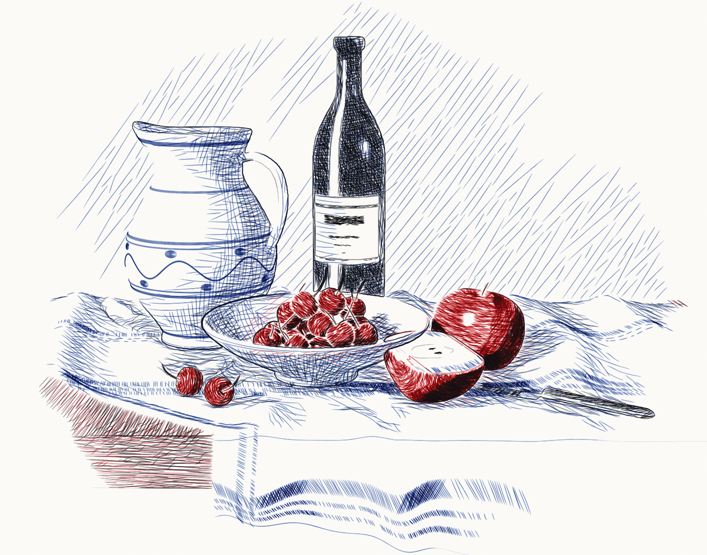
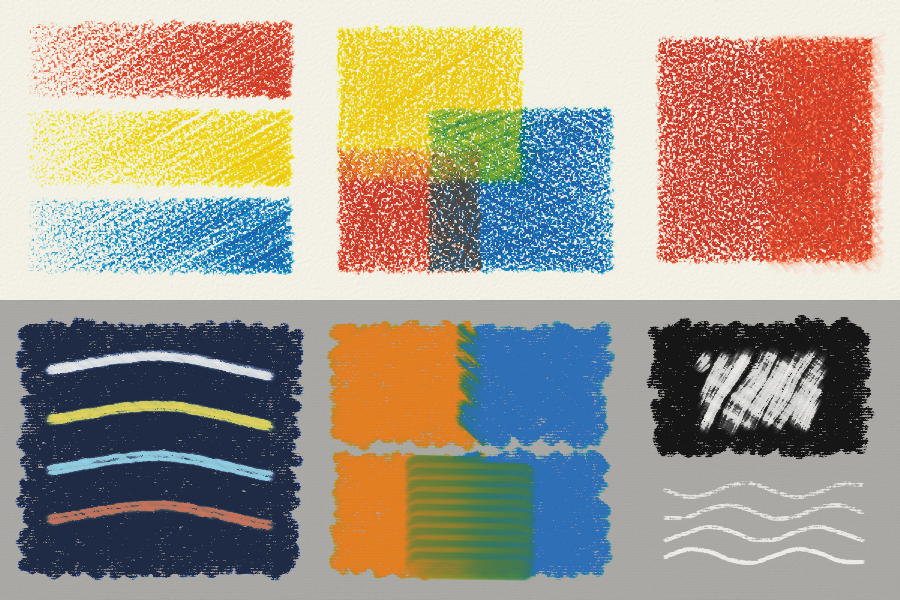
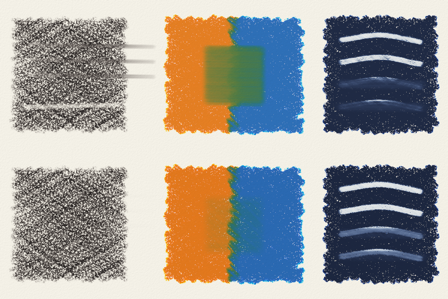
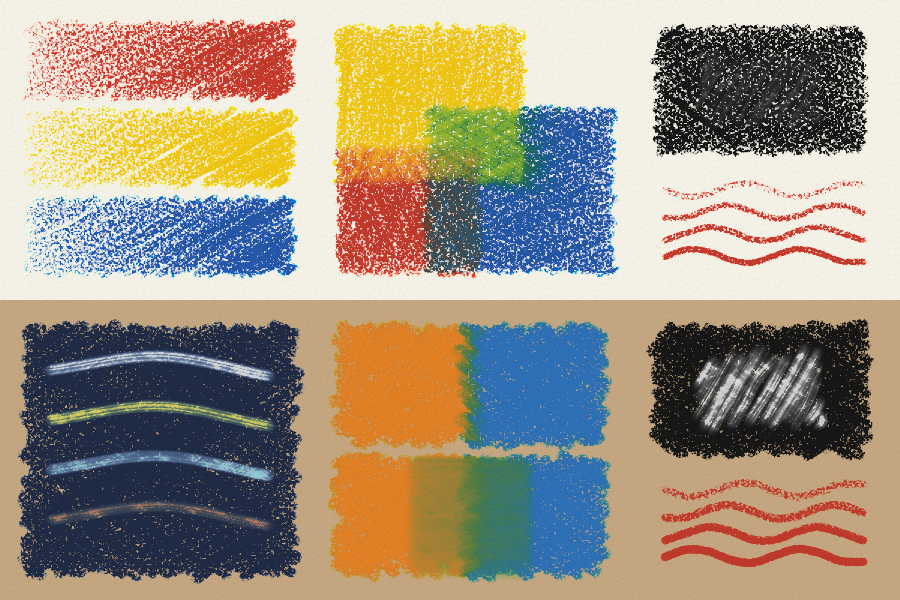
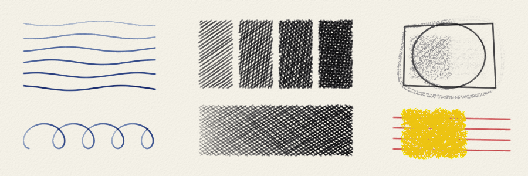
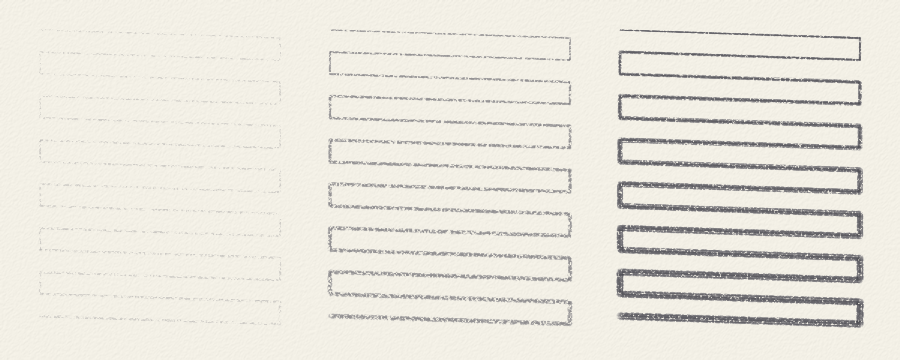
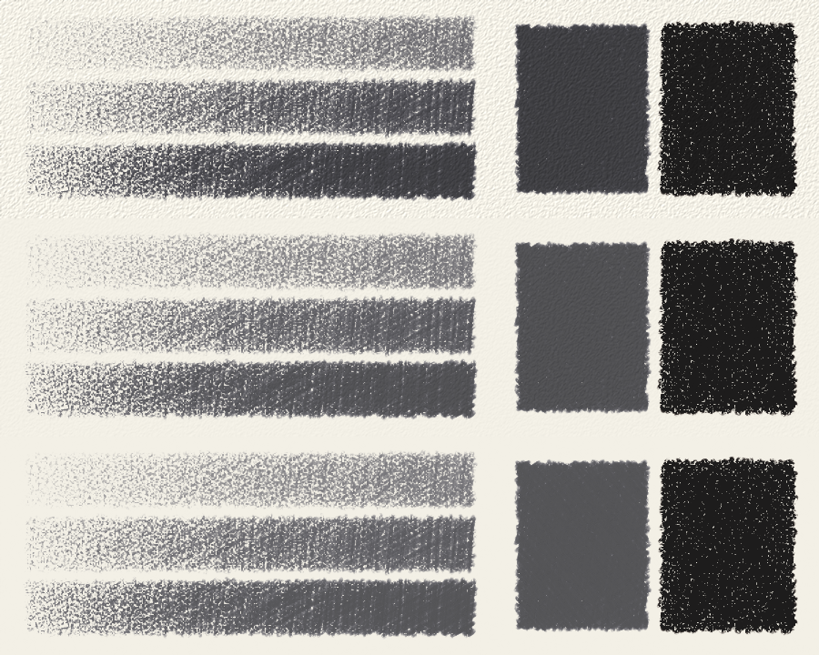

# fusain

[](https://github.com/joce/fusain/actions/workflows/ci.yml)
[](https://codecov.io/gh/joce/fusain)
[](https://github.com/astral-sh/ruff)
[](https://github.com/psf/black)
[](https://github.com/joce/fusain/blob/main/LICENSE)

A drawing simulator for dry and semi-dry media: graphite and coloured pencils,
charcoal, pastel, crayon, ballpoint pen and the like, laid down on a paper with
tooth. Wet media (ink, felt-tip markers, paint) are out of scope; for oil
paint, see the sister project [oilpaint](https://github.com/joce/oilpaint).
The two share their colour science and stroke paths through
[murex](https://github.com/joce/murex).

Early days. So far there are papers, graphite and coloured pencils, charcoal,
soft, hard and oil pastels, wax crayons, ballpoint pens, stumps and erasers. Tone depends on how hard a stick is pressed and
how many layers are laid, as on real paper. Charcoal and pastel leave dust
that a stump drags about and an eraser lifts; coloured pencils are waxy and
translucent, so their layers mix to the eye; a light pastel covers a dark one.
Crayons and oil pastels leave a film of wax that dry media hardly take over.
A point wears as it draws, until it is sharpened. Heavy graphite shines under
the lamp. Fixative sets the dust. The plan for the rest is in
[docs/design.md](docs/design.md).

```python
from fusain import Sheet, papers, pencils

sheet = Sheet(800, 600, paper=papers.CARTRIDGE, seed=1)
sheet.stroke([(100, 300), (300, 220), (500, 320)], pencils.B2, pressure=0.6)
sheet.shade((100, 360, 500, 520), pencils.HB, pressure=0.4)             # an even tone
sheet.shade((100, 360, 500, 520), pencils.HB, pressure=0.4, angle=-40)  # a second layer, across
sheet.stroke([(100, 560), (500, 550)], pencils.B4, tilt=1)             # with the side of the lead
sheet.save("drawing.png")
```

## Four drawings made with it

Each is a single script where every mark is a `sheet.stroke(...)`, or the
pass of a stump, a finger or an eraser; numpy only decides where the marks
go. None is copied from a picture. Each subject is first built in space (a
tower, a street, a bird, a table of things), lit and looked at through a
camera, and the medium is then laid along the forms that result.

* `examples/deco.py`: a sketch of an imagined art deco tower, in charcoal on
  a cream paper. The shadow faces are toned up the wall and rubbed with a
  stump, the cast shadows hatched the way the light falls, the windows drawn
  strip by strip between their piers; the sky is vine charcoal rubbed with a
  finger, and the building is lifted back out of it with a kneaded eraser
  (about 7,900 strokes and 1,700 rubs, under a minute).
* `examples/broadway.py`: Broadway in SoHo on an autumn afternoon, in soft
  pastel on toned paper. Blocked in with the side of the stick, rubbed and
  fixed; then each cast-iron front in strokes that run with the perspective,
  the roadway, the trees in broken dabs, the cabs and the people, each a
  body in a pose drawn in a handful of strokes; the brightest touches last
  (about 32,500 strokes, under a minute).
* `examples/macaw.py`: a great green macaw in coloured pencil on white
  paper. The bird is a solid model (`examples/macaw_model.py`) whose
  proportions were measured on several photographs of the species, posed and
  lit; the pencil goes on darks first, each colour hatched lightly and then
  stroked along the lie of the feathers, with the head carried furthest
  (about 32,500 strokes, about a minute).
* `examples/stilllife.py`: a still life in blue, black and red ballpoint. A
  jug, a bottle, a bowl of cherries, apples and a striped cloth are built as
  solids and lit; the pen then works patch by patch, laying bundles of
  strokes that follow each form wherever tone is still wanting. Red is the
  fruit, blue the shadows on white things, the jug's pattern and the cloth's
  stripes, black the darkest places (about 11,200 strokes, a minute and a
  half).



*An imagined setback skyscraper of the 1930s, in charcoal: vine and
compressed charcoal, a stump, a finger and a kneaded eraser, on a cream paper
with an irregular tooth.*



*Broadway in SoHo on an autumn afternoon, in soft pastel on toned paper: the
sun low behind the left shoulder, so the fronts on the right are lit and the
left side lays its shadow across the street.*



*A great green macaw in coloured pencil: built from measured proportions,
then drawn darks first, each colour stroked along the feathers.*



*A still life in blue, black and red ballpoint, every tone a hatching that
follows its form: the highlights are bare paper, and the inks mix only where
their lines cross.*

## The media


Top: 4H, 2H, HB, 2B, 4B, 6B and 8B, each shaded with the pressure rising from
left to right. Bottom left: HB at a light pressure in 1, 2, 4 and 8 layers.
Bottom middle: a 4B held on its side (`tilt=1`), which marks a broad, soft,
grainy band. Bottom right: 2B lines drawn lightly, firmly and hard, and
cross-hatching.

Sizes are in pixels, and the paper's `grain` sets the scale: a pencil line is
two or three grains wide.

```python
from fusain import charcoal, tools

sheet.shade((100, 60, 500, 200), charcoal.VINE, pressure=0.6, width=14)
sheet.smudge([(120, 130), (560, 130)], tools.STUMP)    # drags the dust along
sheet.erase([(100, 170), (500, 170)], tools.KNEADED)   # lifts it
sheet.rub((100, 60, 600, 200), tools.FINGER)           # blends a whole area
```


Vine charcoal, compressed charcoal and a 4B pencil on Ingres paper. Across all
three, from the top: untouched; a stump dragged through and out onto the bare
paper; a finger rubbed to and fro; a kneaded eraser pulled through three
times; a vinyl eraser pulled through once.

```python
from fusain import pastels

sheet.shade((100, 60, 300, 200), pencils.coloured("#2456a6"), pressure=0.7)
sheet.shade((200, 60, 400, 200), pencils.coloured("#f2c40f"), pressure=0.7)  # green where they overlap
sheet.shade((100, 60, 400, 200), pencils.BLENDER, pressure=1.0)              # burnish: the white specks close
# build colour in light layers (pressure about 0.3): ten or so go on before the wax resists.
# Press a layer hard and it fills and polishes the tooth, and little will take over it.
sheet.stroke([(100, 300), (400, 320)], pastels.soft("#f4f1ea"), pressure=0.8, width=14)
```



Top, coloured pencils on cartridge paper. Left: red, yellow and blue, lighter
to firmer. Middle: the same three laid over one another: green, orange and
violet where two overlap. Right: three layers of red, the right half then
burnished with a colourless blender. Bottom, soft pastels on grey laid paper.
Left: light colours over a dark blue ground, which they cover. Middle: orange
and blue side by side, and the same with the join rubbed with a finger. Right:
white pastel over black, and lines drawn with a hard pastel.

```python
sheet.fix()   # fixative: the dust stays where it is, and takes more layers
# the tooth is full of pastel after five or six layers; fix between stages, as a pastellist does,
# and a light pastel covers a heavily worked dark one again.
```



The same drawing rubbed alike twice; the bottom one was sprayed with fixative
first. Left: vine charcoal, a stump dragged through and a kneaded eraser
pulled through. Middle: orange and blue pastel, the join rubbed with a finger.
Right: white pastel strokes laid over a dark ground after the fixative, the
lower two rubbed with a finger.

```python
from fusain import crayons

sheet.shade((100, 60, 300, 200), crayons.wax("#c0392b"), pressure=0.6, width=9)
sheet.shade((100, 260, 300, 400), pastels.oil("#e67e22"), pressure=0.7, width=14)
```



Top, wax crayons on cartridge paper. Left: red, yellow and blue, lighter to
firmer. Middle: the same three laid over one another. Right: a white crayon
over a black one, which it does not cover, and lines drawn lighter to firmer.
Bottom, oil pastels on tan paper. Left: light colours over a dark blue ground,
which they half cover. Middle: orange and blue side by side, and the same with
the join rubbed with a finger. Right: white oil pastel over black, and lines
drawn lighter to firmer.

```python
from fusain import pens

sheet.stroke([(100, 300), (400, 320)], pens.BLUE, pressure=0.6)
sheet.shade((100, 60, 300, 200), pens.BLACK, pressure=0.4, angle=35)   # hatching
```



Left: lines from the lightest touch to the firmest, and loops as a hand writes
them. Middle: hatching in one to four layers, and one layer pressed lighter to
firmer. Right: a pencil sketch inked over, its right half then rubbed with an
eraser, which takes the pencil and leaves the ink; and a red pen skidding
across a patch of wax crayon.

```python
from fusain import Stick

pencil = Stick(pencils.B6, width=2)      # a sharp point, which wears as it draws
sheet.stroke([(100, 400), (700, 420)], pencil)
print(pencil.width)                       # wider than 2 now
pencil.sharpen()
```



One line drawn back and forth down the sheet without sharpening, with a 2H, a
2B and a 6B, each sharp at the top: the softer the lead, the sooner its point
is a flat and its line a band.

```python
image = sheet.render()                    # under the default lamp, graphite shines a little
image = sheet.render(light=(0, 0, 1))     # lamp overhead: heavy graphite turns silvery
image = sheet.render(gloss=0)             # matte, as a scanner sees it
```



One drawing under a raking lamp, the default lamp and a lamp straight
overhead. Left: an HB, a 4B and an 8B, lighter to firmer. Right: three firm
layers of 8B beside three of compressed charcoal. The higher the lamp, the
more the heavy graphite mirrors it; the charcoal stays black.


The papers of `fusain.papers` under a raking light: cartridge, printer paper,
Bristol, newsprint, Ingres, cold-pressed; rough, sanded card, toned grey, toned
tan, black.

## Development

```bash
uv sync --group dev --frozen   # install the package and the development tools
uv run pytest                  # run the tests (the first run compiles the numba kernels)
make pre-push                  # what CI runs: tox, coverage, spelling
```

## License

[MIT](LICENSE)
