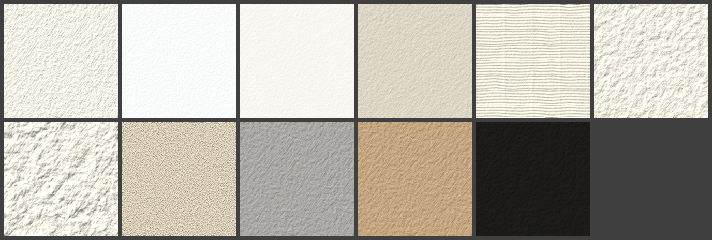

# fusain

[](https://github.com/joce/fusain/actions/workflows/ci.yml)
[](https://codecov.io/gh/joce/fusain)
[](https://github.com/astral-sh/ruff)
[](https://github.com/psf/black)
[](https://github.com/joce/fusain/blob/main/LICENSE)

A drawing simulator for dry and semi-dry media: graphite and coloured pencils,
charcoal, pastel, crayon and the like, laid down on a paper with tooth. Wet
media (ink, felt-tip markers, paint) are out of scope; for oil paint, see the
sister project [oilpaint](https://github.com/joce/oilpaint). The two share their
colour science and stroke paths through [murex](https://github.com/joce/murex).

Early days. So far there is the paper, and a sheet of it that can be rendered;
nothing to draw with yet. The plan is in [docs/design.md](docs/design.md).

```python
from fusain import Sheet, papers

sheet = Sheet(800, 600, paper=papers.INGRES, seed=1)
sheet.save("paper.png", light=(-0.6, -0.8, 0.45))   # a raking light
```



The papers of `fusain.papers` under a raking light: cartridge, printer paper,
Bristol, newsprint, Ingres, cold-pressed; rough, sanded card, toned grey, toned
tan, black.

## Development

```bash
uv sync --group dev --frozen   # install the package and the development tools
uv run pytest                  # run the tests
make pre-push                  # what CI runs: tox, coverage, spelling
```

## License

[MIT](LICENSE)
